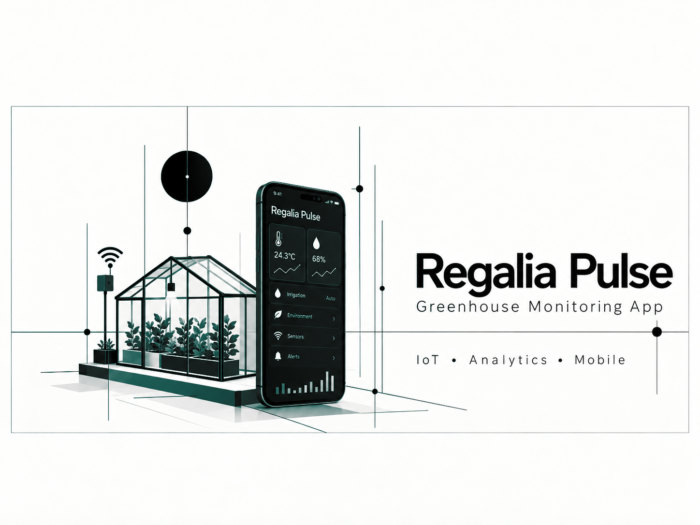

### A field companion experience for reviewing greenhouse measurements, operational context, and synchronized reports.

## Overview

Regalia Mobile brings greenhouse observations to a compact field interface so users can review current conditions, historical context, alerts, and synchronized datasets away from the sensor station.

## My Contributions

- Designed the mobile-facing information hierarchy
- Connected environmental and operational measurements to field workflows
- Defined secure synchronization boundaries for private greenhouse data
- Kept the interface usable under intermittent connectivity

## Project Highlights

- Mobile greenhouse overview
- Environmental and soil context
- Offline-aware synchronization
- Operational reports and alerts

## System Architecture

The application consumes encrypted, device-produced data packages and presents a mobile-friendly view without exposing the acquisition system or raw private repository.

## Tech Stack

`Mobile UI` `Encrypted data synchronization` `Time-series data` `CSV/JSON interoperability` `Offline-first workflows`

## Results

- Made field data easier to inspect away from the device
- Preserved private data boundaries during synchronization
- Connected acquisition, reporting, and mobile review

## Screenshots

Additional sanitized product screenshots will be added when they can be shared without exposing private data or infrastructure.

## What I Learned

Field applications must assume unstable connectivity and make data age, synchronization status, and measurement limitations visible.

## Privacy and Ownership

> Portfolio documentation only. Application code, synchronization keys, device identifiers, sensor data, and operational endpoints remain private.

## Contact

- [LinkedIn](https://www.linkedin.com/in/dev-ai-erick)
- [GitHub](https://github.com/DevDope)

---

This repository is maintained as a professional portfolio case study. No license to proprietary source code or private assets is granted.
